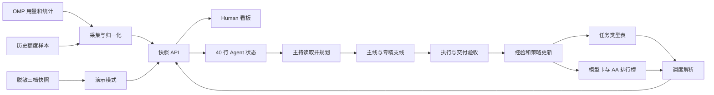

# 架构说明

## 边界与数据流

面板把账户额度、历史消耗与调度依据收敛为一个快照。前端负责呈现和交互；服务端负责数据获取、策略解析、状态落盘与访问控制。离线静态文件和演示服务共享同一批脱敏快照。

演示服务对每次快照请求读取对应 JSON，重新解析调度文件，并保留快照中的真实模型轮次。静态模式直接加载 `demo-snapshots.js`；网络请求失败或静态托管缺少 API 时使用这份固定快照。真实模式从 OMP、`stats.db` 与历史采样生成数据；运行时数据和密码配置按独立目录存放。

## Human-to-Dashboard

人需要快速发现问题、比较选项并追踪细节：用量页展示需关注窗口、消费、账户卡片和走势；任务页把主持、设计与审查编排为主线，执行任务按属性进入四条专精支线；能力页按模型与努力档展示 AA 分数、成本、轮次和渠道额度。所有数据可随时间范围切换，点击关卡可查看备选与禁用项。

## Dashboard-to-Agent

代理需要可预测、紧凑的运行上下文。`当前状态.md` 包含采样日期、各渠道用量、重置时间、过期标记与风险提示，上限 40 行。超过上限时优先保留高用量与风险项；过期读数标为未知。主持在规划前读取状态，结合任务表指定最低能力档位，并根据可用额度选择渠道。该文件是消费端协议，完整历史和依据仍保留在数据源中。

## 外包判断与验收

外包决策由主持结合预设能力门槛、错误代价和可验证性完成。启动卡记录的一次试跑中，六个低成本模型有三个把超出自身能力的步骤标成可做；样本较小，只能作为风险提示。任务书应写清输入、输出和验收标准，执行者提交可核查证据，主持或脚本按标准检查。客观计数可由程序复核；高代价且难以自动验证的判断需要合适能力档位与独立审查。

## 主持成本

长会话每一轮通常需要处理不断增长的上下文，因此可用「有效上下文长度 × 轮次」粗略估计主持处理规模。实际费用还受输入、输出、缓存命中、压缩与提供方计价影响，不能将该乘积直接当作账单。子代理有启动与交接成本：短步骤可留给主持，边界清楚、耗时较长且可以验收的工作适合合并后派发。

## 任务流闭环

1. 主持读取状态，标记额度风险和过期读数。
2. 结合任务类型表，为每个步骤设定最低档、首选、替代与禁用项。
3. 大任务经设计关卡后分配到工程、写作、情报或运维支线。
4. 关卡执行者提交产物和证据；交付前按风险与方案要求检查。
5. 将可复核的结果和适用边界回填经验，达到既定证据门槛后更新策略。

界面中的流图用于展示调度关系，实际委派仍由使用者或代理执行。模型卡与 AA 排行榜为有日期的证据快照，单次试跑应标记为弱证据。

## 公网访问边界

两个监听器均绑定本地回环。公网源站在独立端口验证密码哈希与签名会话，设置限流和安全响应头；HTTPS 终止、边界访问策略及代理信任由部署者配置。演示模式默认不开放公网端口，也不会自动修改 Tailnet 配置。静态演示数据经脱敏处理，真实 OMP 数据需要独立授权和发布前审查。
