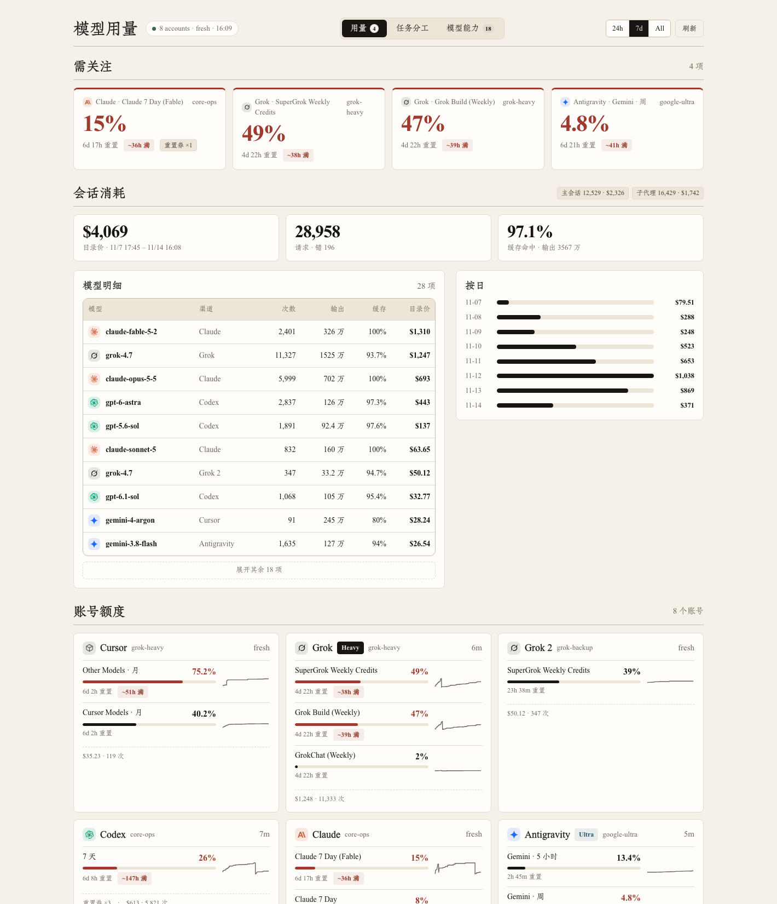
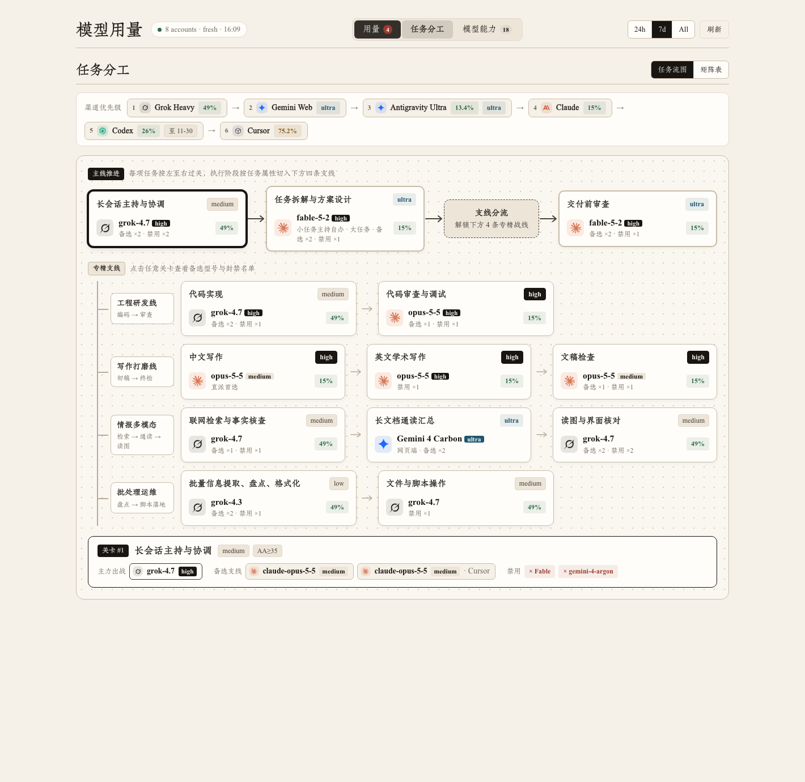
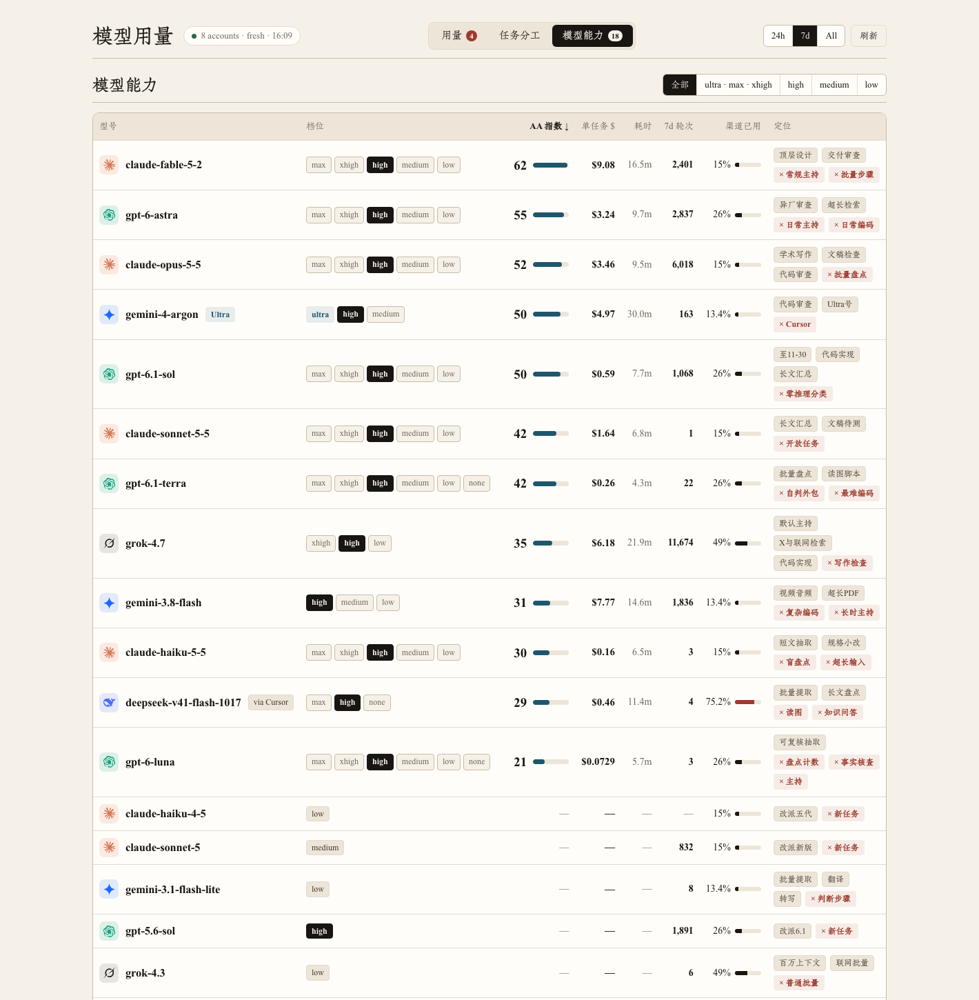
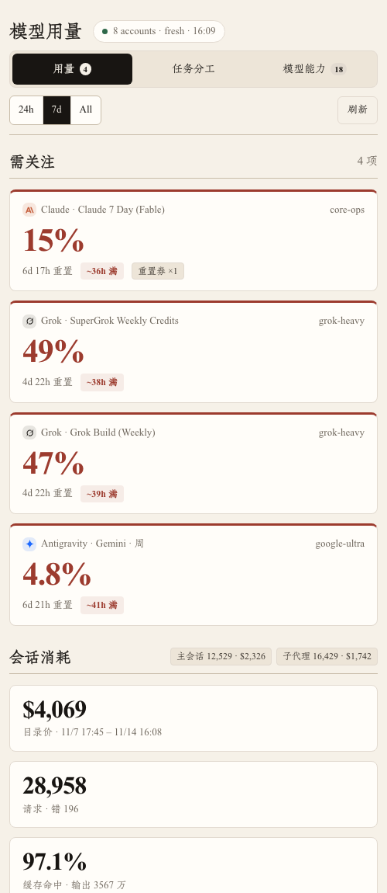

# AI Usage & Dispatch Dashboard

一套面向人和 AI 代理的本地用量与模型调度面板。演示数据来自一组经脱敏处理的真实历史快照，保留额度曲线、消费金额、请求轮次与 Artificial Analysis（AA）分数。账号、账户标识与个人路径已替换；这些历史数值仍可能反映使用习惯，发布自己的快照前请自行复核。

## 核心功能

- **Human 看板层**：按 24 小时、7 天和全部历史查看用量、告警、会话消耗与账号额度。
- **Agent 状态协议层**：服务端生成不超过 40 行的 `当前状态.md`，集中表达额度、重置时间、读数新鲜度与风险。
- **RPG 任务流图**：主线连接主持、方案设计和交付审查；四条专精支线承载执行任务。点击关卡查看首选、备选与禁用项。
- **模型能力矩阵**：同一模型可切换原生 `low` 到 `ultra` 等努力档位，联动显示 AA 指数和单任务成本，并支持排序与筛选。
- **厂商图标库**：`vendor-icons.js` 以纯内联 SVG 提供可复用的厂商标记，无需外部图标请求。
- **双端口公网鉴权**：本地端口限制回环访问；公网源站端口要求独立密码与签名会话，提供限速、CSRF 约束和安全响应头。部署时还需由 HTTPS 反向代理提供传输加密，并配置网络访问策略。

## 界面预览

### 用量总览


### 任务分工


### 模型能力


### 手机视图


## 快速开始

### 直接打开

双击 `index.html`。浏览器通过 `demo-data/demo-snapshots.js` 读取本地快照，时间范围、标签、关卡、档位与排序均可交互。GitHub Pages 也可按此方式托管静态文件。静态模式使用固定快照；变更调度文档后可使用服务端模式实时解析。

### 启动演示服务

需要 Python 3.10 或更新版本，标准库即可运行：

```sh
python3 server.py --demo --no-open
```

访问 <http://127.0.0.1:3927/>。演示模式无需 OMP、账号令牌或历史数据库，默认关闭公网端口、后台采样和 Tailnet 发布。编辑 `demo-data/dispatch/任务类型表.md`、模型卡或 AA 表，刷新页面即可重新解析；每次请求会刷新 `demo-data/dispatch/当前状态.md`。快照日期为历史采样时间，界面的重置倒计时会随当前时间变化。

### 接入真实 OMP

安装并登录 OMP，确保 `omp` 可从 PATH 调用，另准备兼容的调度文档与 AA 表：

```sh
export PI_CONFIG_DIR="$HOME/.omp"
export USAGE_DISPATCH_DIR="/path/to/dispatch"
python3 server.py --no-open
```

`PI_CONFIG_DIR` 指定 OMP 配置与 `stats.db`；`USAGE_DISPATCH_DIR` 指向包含 `任务类型表.md`、`模型卡/`、`AA排行榜-*.tsv` 的目录，状态文件也写到该目录。可用 `USAGE_DATA_DIR` 和 `USAGE_AUTH_DIR` 分别指定历史数据库与密码配置目录，默认都位于项目目录内。真实模式读取账户、消费与配额，并会定期写入历史样本和状态文件；请先核对目录权限。

需要公网入口时，先在本机运行 `python3 server.py --set-password`，再显式指定 `--public-port 3928`。端口只绑定 `127.0.0.1`；由可信 HTTPS 反向代理连接该端口，并限制访问代理源站。登录限流按直连地址计算，共用代理的访问者共用限额。可选 `--publish-tailnet` 通过本机 Tailscale 发布本地端口；该操作会更改 Tailscale Serve 配置，请先检查现有设置。以上密码方案是一层应用认证，完整零信任部署还需独立的身份、设备、网络和审计控制。

### 运行验收

```sh
python3 test_demo.py
```

测试使用标准库和 Node.js。存在 Chrome 时会额外运行真实浏览器交互；缺少 Chrome 的环境会标记浏览器测试跳过。

## 目录结构

```text
index.html                         双模式前端
server.py                          OMP / 演示服务与鉴权
test_demo.py                       隐私、功能及浏览器验收
vendor-icons.js                    内联 SVG 厂商图标
assets/                            字体及字体许可
screenshots/                       脱敏演示服务的实机截图
demo-data/snapshots/               三档 JSON 快照
demo-data/demo-snapshots.js        静态模式快照
demo-data/dispatch/                启动卡、任务表、状态、排行和模型卡
```

## 数据与许可

AA 数据为 2026-11-14 的历史截面，适合展示分档与数据流；价格、型号和能力不代表现况或采购建议。账户数据采用演示地址与替代标识，使用真实环境时请勿公开令牌、配置或未经复核的快照。

项目代码采用 [MIT License](LICENSE)。`assets/zhuque.woff2` 为 [朱雀仿宋](https://github.com/TrionesType/zhuque)，独立采用 [SIL Open Font License 1.1](assets/OFL-1.1.txt)。厂商标记仅用于识别对应服务，相关名称和图形的权利归各自权利人所有。
